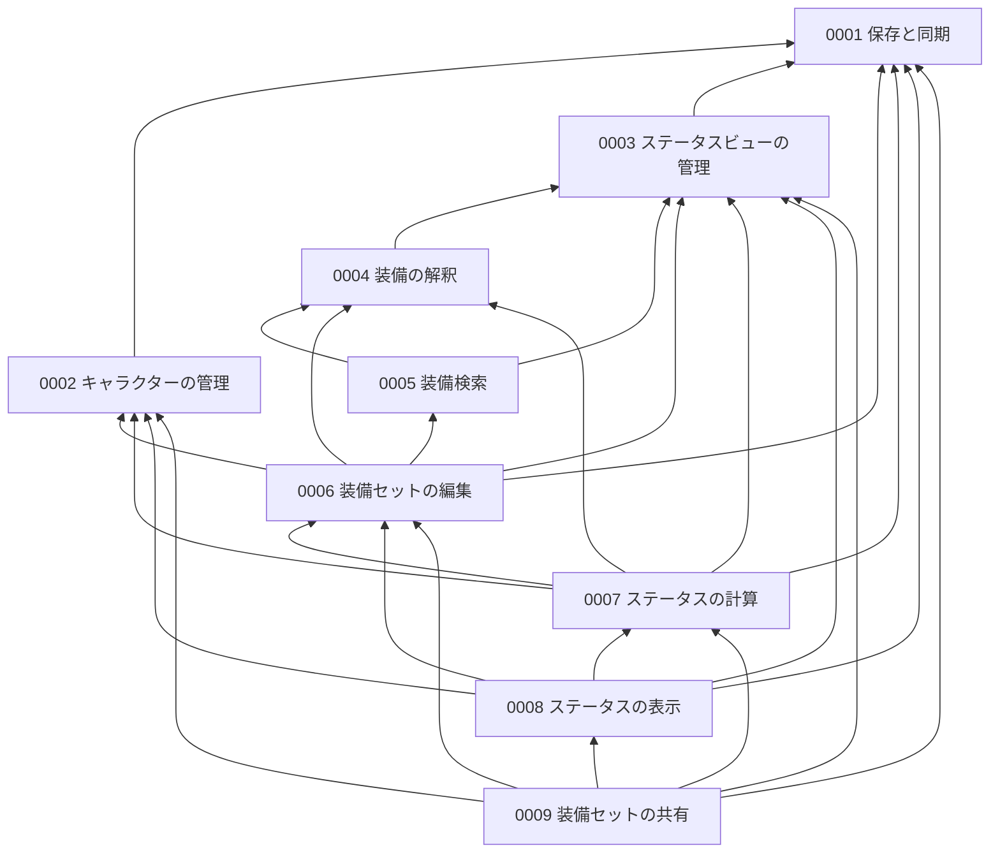

# 仕様書の一覧

ff11sim の機能ごとの仕様書。語は [用語集](../../../CONTEXT.md) と、各仕様書の「用語」節に従う。

## 番号と依存の規則

- 番号は依存の順に振る。仕様書は、自分より小さい番号の仕様書にだけ依存する。新しい仕様書は末尾の番号で足し、既存の番号は振り直さない。
- 「依存する」とは、依存先の仕様書が定義した語や振る舞いに頼って受け入れ基準を書くこと。依存先は各仕様書の冒頭の一文に挙げる。
- 語は、その語の規則に頼って受け入れ基準を書く仕様書のうち、最も上流のものが定義する。下流の仕様書の語を名前だけ使うとき（前方参照）は、初出に「（→ NNNN）」を付け、依存には数えない。
- ファイルは平らに置き、領域のまとまりはこの一覧で示す。

## 領域ごとの一覧

| 領域 | 仕様書 | 何を決めるか |
|---|---|---|
| 土台 | [0001 保存と同期](0001-saving-and-sync.md) | 保存先（端末内データ / アカウントデータ）、ログイン、同期、初回アップロード、未保存の変更と未保存の確認ダイアログ |
| キャラクター | [0002 キャラクターの管理](0002-character-management.md) | キャラクターの登録・編集・削除・並び替え、入力値の上限 |
| ステータス | [0003 ステータスビューの管理](0003-status-view-management.md) | ステータスビューの種類と中身、カスタムステータスビューとユーザー定義プロパティの作成・編集・削除 |
| 装備 | [0004 装備の解釈](0004-equip-interpretation.md) | 装備 1 つのテキストからプロパティの値を拾う規則 |
| 装備 | [0005 装備検索](0005-item-search.md) | アイテムデータを検索・絞り込み・並べ替えする画面 |
| 装備 | [0006 装備セットの編集](0006-equipset-editing.md) | 装備セットの作成・保存・削除・並べ替え、スロットへの装備、オーグメント、カスタム説明、サポートジョブとステータスビューの選択 |
| ステータス | [0007 ステータスの計算](0007-status-calculation.md) | 計算の入力と、寄与・内訳・有効スキル値、いつ計算し直すか |
| ステータス | [0008 ステータスの表示](0008-status-display.md) | ステータス欄、ステータスビューの選択の復元、内訳モーダル |
| 共有 | [0009 装備セットの共有](0009-equipset-sharing.md) | 共有 URL の発行、共有閲覧モード、インポート |

## 依存の図

矢印は「依存する側 → 依存先」。

